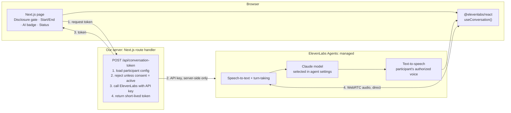

# Architecture

## Goal

Let a user have a low-latency spoken conversation with an AI twin of a consenting participant.
The participant's voice, persona, and consent status come from configuration, so the same
application can serve other consenting participants later.

## System diagram



## Request flow

1. **Disclosure.** The user reads and accepts the AI disclosure. The microphone is not requested before this step.
2. **Token request.** The browser calls our route handler, `POST /api/conversation-token`, with a participant ID.
3. **Consent check.** The server loads the participant's configuration. If consent is not `active`, it returns `403` and the conversation never starts.
4. **Token minting.** The server calls ElevenLabs with the secret API key and gets a short-lived conversation token, which it returns to the browser.
5. **Session.** The browser passes the token to `useConversation().startSession(...)`. From then on, audio flows **directly between the browser and ElevenLabs** over WebRTC.
6. **Turn loop (managed by ElevenLabs).** Speech-to-text → Claude generates a reply → text-to-speech in the participant's voice → audio back to the browser.
7. **End.** The user clicks End, or the session fails. The UI shows the resulting state.

## Who does what

| Responsibility | Owner | Notes |
|---|---|---|
| Speech recognition, turn-taking, interruptions | ElevenLabs (managed) | Configured in agent settings |
| Conversational reasoning | Claude, called by ElevenLabs | Model chosen in agent's LLM setting |
| Voice synthesis | ElevenLabs (managed) | Uses the participant's PVC voice once it is trained and verified |
| In-session conversation state | ElevenLabs (managed) | |
| UI, disclosure, status and error states | **Us** | `src/app`, `src/components` |
| API-key custody and token minting | **Us** | Route handler, server-only |
| Consent enforcement | **Us** | At the token choke point |
| Participant configuration | **Us** | Typed config, no secrets |
| Avatar | To be decided (Phase 4) | See risks |

## Key design decisions

- **Our server is not in the audio path.** It handles one short request per session, so
  conversational latency mostly depends on ElevenLabs and the model. This also means serverless
  hosting is viable.
- **Token minting is the single choke point.** Without a token, no conversation can start, so this
  is where consent, revocation, and (later) access control are enforced.
- **Claude is selected inside the ElevenLabs agent (native integration)**, not called through our
  own proxy. See [ADR 0002](decisions/0002-claude-via-native-elevenlabs-llm.md).

## Planned structure

```
src/
  app/
    page.tsx                          landing + disclosure
    talk/[participantId]/page.tsx     conversation UI (Phase 2)
    api/conversation-token/route.ts   token minting + consent check (Phase 2)
  components/                         ConversationPanel, DisclosureGate, AiBadge, StatusIndicator
  lib/                                elevenlabs.server.ts, participants.ts
  config/participants/                typed, non-secret participant configs
docs/
tests/
```

## Not yet verified

These items are deliberately unconfirmed. Do not rely on them until they are verified.

- The exact Claude model IDs available to the agent. We will check them with the ElevenLabs
  "list LLMs" capability once the agent exists (Phase 2).
- Avatar options and their real-time and lip-sync capabilities (Phase 4).
- Latency numbers. None are claimed until they are measured (Phase 6).
